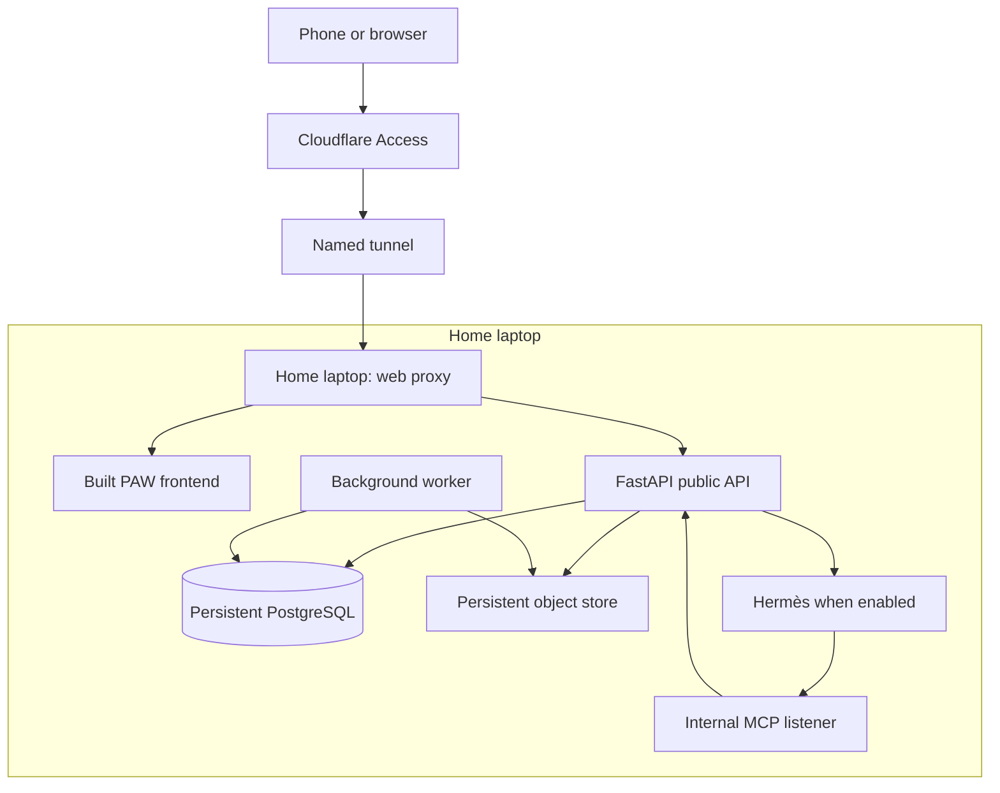
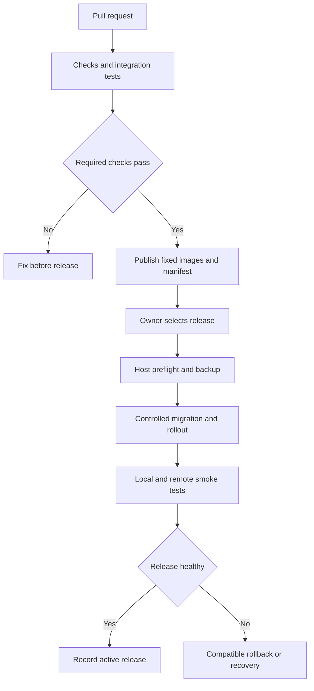

# PAW-001D — Development, Home Hosting and Portable Deployment Foundation

> **Project:** Personal Automation Weaponry (PAW)  
> **Parent story:** PAW-001 — Cloud RAG Foundation  
> **Substory:** PAW-001D — Deployment Foundation  
> **Document version:** 2.0 — 29 October 2026  
> **Status:** Revised development requirements; implementation and acceptance evidence pending  
> **Owner:** Bharat  
> **Primary deployment:** Spare home laptop, persistent local PostgreSQL, one-click startup and authenticated remote web access  
> **Repository:** [bharat948/PAW](https://github.com/bharat948/PAW)  
> **Filename retained:** PAW-001D_Cloud_Deployment_Foundation.md

This revision replaces the mandatory AWS-only deployment design with a home-first deployment contract. It incorporates the discussion of Neon, Railway, Render, Vercel, low-cost VPS hosting, Tailscale, Cloudflare Tunnel and a family-operable launcher. The original cloud options remain migration alternatives.

This is a specification, not evidence that software has been implemented or deployed. Proposed commands, configuration keys and repository additions below require implementation and validation. No laptop configuration, public hostname, hosting purchase or GitHub deployment is asserted as completed.

## Contents

- [1. Outcome and architectural decisions](#1-outcome-and-architectural-decisions)
- [2. Evidence baseline and document precedence](#2-evidence-baseline-and-document-precedence)
- [3. Environments and service profiles](#3-environments-and-service-profiles)
- [4. Home deployment topology](#4-home-deployment-topology)
- [5. People, permissions and operating boundaries](#5-people-permissions-and-operating-boundaries)
- [6. Host selection and one-time prerequisites](#6-host-selection-and-one-time-prerequisites)
- [7. Packaging, configuration and repository work](#7-packaging-configuration-and-repository-work)
- [8. Developer workflow](#8-developer-workflow)
- [9. First-time installation flow — owner or technical maintainer](#9-first-time-installation-flow--owner-or-technical-maintainer)
- [10. One-click launcher contract](#10-one-click-launcher-contract)
- [11. Local PostgreSQL and object persistence](#11-local-postgresql-and-object-persistence)
- [12. Remote access, browser routing and authentication](#12-remote-access-browser-routing-and-authentication)
- [13. Secrets and agent isolation](#13-secrets-and-agent-isolation)
- [14. GitHub-to-home release workflow](#14-github-to-home-release-workflow)
- [15. Stop, restart and interrupted work](#15-stop-restart-and-interrupted-work)
- [16. Backups and disaster recovery](#16-backups-and-disaster-recovery)
- [17. Everyday usage and operational runbooks](#17-everyday-usage-and-operational-runbooks)
- [18. Health, observability and resource controls](#18-health-observability-and-resource-controls)
- [19. Development work packages](#19-development-work-packages)
- [20. Test and release evidence matrix](#20-test-and-release-evidence-matrix)
- [21. Definition of Done and milestone gates](#21-definition-of-done-and-milestone-gates)
- [22. Cost model and hosting alternatives](#22-cost-model-and-hosting-alternatives)
- [23. Future VPS and cloud migration](#23-future-vps-and-cloud-migration)
- [24. PAW-002 handoff and later stories](#24-paw-002-handoff-and-later-stories)
- [25. Open inputs, ADRs and implementation sign-off](#25-open-inputs-adrs-and-implementation-sign-off)
- [26. Revision history and source references](#26-revision-history-and-source-references)

## 1. Outcome and architectural decisions

### 1.1 The outcome we are building

After one-time technical setup, a family member can switch on the spare laptop, sign in if the operating system requires it, open **Start PAW**, and wait for a clear readiness message. Bharat can then open a fixed HTTPS address from a phone on mobile data, authenticate and use PAW.

The laptop runs the deployed application and its database. Routine startup uses the installed release and existing data. Development, upgrades, migrations and recovery are separate owner workflows.

A successful release proves all of the following:

1. The current development workflow remains convenient on the developer machine.
2. A tested release installs reproducibly on the home laptop.
3. One launcher starts the required services and reports actual readiness.
4. Documents, jobs and other committed application records survive normal restarts and application replacement.
5. The application can be used from an outside network through the selected authenticated access route.
6. Backup data exists outside the laptop and can restore a working installation.
7. The deployment can later move to a VPS or managed services using documented configuration and data migration steps.

### 1.2 Decisions, recommendations and remaining inputs

| Topic | Position in this revision | Status |
|---|---|---|
| Initial compute | Use the spare home laptop for the deployed web application and server services | User-selected direction |
| Primary database | Local PostgreSQL with pgvector and persistent storage | User requirement |
| Everyday startup | One desktop action starts PAW and remote connectivity | User requirement |
| Local operator | A nontechnical family member can start the system on Bharat's instruction | User requirement |
| Remote use | Bharat accesses PAW through a web interface from outside the home | User requirement |
| Application packaging | Separate containers sharing one host, managed through Docker Compose | Recommended implementation |
| Browser access | Named Cloudflare Tunnel plus Cloudflare Access | Recommended default; account/domain setup pending |
| Private administration | Tailscale for restricted remote administration; private web access is also an alternative | Optional |
| Host operating system | Dedicated supported Linux installation preferred; Windows path remains supported if selected | Laptop OS unknown |
| Remote primary database | Neon/RDS deferred; local primary storage is the current baseline | Revised from the original cloud plan |
| Off-device recovery | Automated encrypted backups outside the laptop | Required engineering safeguard |
| Paid cloud hosting | Optional later migration, not a prerequisite for this milestone | Deferred |
| Hardware sizing | Confirm actual CPU, RAM, SSD, free disk, network and uptime constraints | Open input |

**Persistence trade-off:** the earlier architecture kept the live database independent of application compute. The selected home design places both on the laptop. Off-device backups provide recovery, but do not provide an always-running replacement database or automatic failover.

### 1.3 Scope

**PAW-001D delivers:** environment contracts, container packaging, host installation, launcher, local persistence, remote access, browser authentication, release delivery, backups, operational runbooks and acceptance tests.

**PAW-002 delivers:** the Hermès adapter, session authority, agent memory, governed tools, approvals and evaluations. PAW-001D supplies a compatible runtime slot and lifecycle integration.

Subagents, ticketing, autonomous deployment permissions, arbitrary agent code execution, multi-host orchestration and high availability remain later work.

The first release supports one owner and a controlled workload. Requirements for other users, customers or production service-level commitments must be evaluated before expanding use.

## 2. Evidence baseline and document precedence

### 2.1 Repository observations retained from the original document

The earlier repository review recorded commit **4feffa93c4a8872b42600c596cf248db17507676** on main. These are historical observations carried forward, not a fresh audit of the current branch.

| Area | Previously observed | Consequence for development |
|---|---|---|
| Monorepo | paw-server and paw-web | Retain one repository |
| Backend | Python 3.12, FastAPI, SQLAlchemy and Alembic | Extend existing configuration and migration paths |
| Frontend | React, Vite and TypeScript | Deploy a built static frontend |
| Database | PostgreSQL with pgvector | Reuse the database model and validate pinned extensions |
| Object storage | SeaweedFS with S3-compatible access | Reuse the existing storage adapter for the home deployment |
| Worker | PostgreSQL-backed job leases | Preserve durable work and verify interruption handling |
| Local development | Root dev.sh starts Docker infrastructure and host application processes | Preserve fast development |
| Containers | Dockerfile and Compose definitions exist | Add deployment profiles without breaking existing commands |
| CI | Separate server and web workflows | Expand release packaging and evidence collection |
| Authentication | Owner bearer token entered into the browser | Replace for remotely accessible deployments |

Previously recorded commands include:

- ./dev.sh and ./dev.sh stop
- make -C paw-server check
- make -C paw-server test-integration
- npm run check
- npm run test:e2e
- npm run test:live

The implementer must confirm current paths, commands, settings and the active commit before changing code. Record the new inspection in the implementation PR.

### 2.2 Related specification checked for this revision

The current **PAW_002_Admin_Hermes_Harness_Requirements_v2.docx**, dated 29 October 2026, establishes:

- PAW's PostgreSQL ledger as the proposed conversation authority, using per-run rehydration, subject to the S0 integration spike.
- One Admin Hermès runtime with a constrained MCP tool surface.
- GitHub integration and one approval-gated sandbox write; Gmail is deferred.
- Native shell, browser and file/code-execution tools deferred to later work.
- Interrupted Hermès runs treated as terminal and not automatically replayed.

This deployment specification preserves those boundaries. Hosting the runtime on a laptop does not add agent permissions or change its recovery contract. This task updates only this Markdown document; companion DOCX files require their own revisions.

### 2.3 Precedence

1. Explicit user decisions recorded in this revision govern the deployment target.
2. Application behavior and agent authority remain governed by their respective stories.
3. Repository implementation is evidence of what exists, not proof that an untested requirement has passed.
4. Provider capabilities and prices must be rechecked before provisioning.
5. A conflict between specifications must be recorded and resolved; it must not be hidden by marking a test passed.

## 3. Environments and service profiles

### 3.1 Environment matrix

| Property | Development | Integration / release testing | Home deployment | Later cloud deployment |
|---|---|---|---|---|
| Primary user | Developer | Developer / CI | Bharat; family member starts host | Bharat / future authorized users |
| Web | Vite with hot reload | Built frontend container | Built frontend served locally | Same container or static hosting |
| API / worker | Host processes | Containers | Containers | Containers or selected platform |
| PostgreSQL | Local Docker, development data | Isolated disposable database | Persistent local production data | Local VPS database or managed PostgreSQL |
| Objects | Local SeaweedFS | Isolated test store | Persistent local S3-compatible store | Local store or external S3-compatible service |
| Hermès | Optional Story 2 development runtime | Fake or real runtime as test requires | Enabled only after Story 2 integration | Same verified adapter/runtime contract |
| Access | Localhost | Loopback / private CI network | Authenticated tunnel or private Tailscale | Authenticated HTTPS |
| Secrets | Gitignored development values | Test-only secrets | Restricted host-side secrets | Host secret files or managed secrets |
| Release behavior | Edit and reload | Test fixed images | Start installed release; owner-managed updates | Promote fixed images |

Home deployment is a real deployment environment even though it is physically at home. It must not use the developer database, a debug server or an uncommitted working tree.

### 3.2 Foundation and agent-enabled profiles

| Profile | Required services | Readiness rule |
|---|---|---|
| Foundation | Frontend/proxy, API, worker, PostgreSQL, object storage and selected access connector | Story 1 application is usable |
| Admin agent | Foundation plus the verified Hermès runtime and PAW-002 modules | Foundation and required Story 2 checks pass |

One launcher serves both profiles. The installed release manifest declares which profile is enabled.

Before PAW-002 is installed, the launcher must not start a placeholder Hermès service or falsely report agent functionality as available. Later, if Hermès is required but unhealthy, the interface must report that capability as unavailable even if documents remain accessible.

### 3.3 Local development networking

Use host-reachable loopback addresses for developer tools and Docker service names between containers. A container's localhost refers to itself.

If the development Hermès container needs a host-based MCP service, use the documented host gateway or bridge address with restricted binding/firewall rules. The home deployment uses an internal container listener instead. No production MCP listener is published through the web proxy.

### 3.4 Test isolation

Integration tests use distinct project names, database volumes, object namespaces and credentials. Tests may clean up only resources explicitly belonging to their test environment.

Production data must not be copied into CI by default. Use deterministic fixtures. An isolated restore drill can use a protected backup on a controlled host.

A continuously running cloud staging environment is not required for the initial budget. An ephemeral release-test stack is sufficient if its results are retained.

## 4. Home deployment topology

The diagram describes the recommended Cloudflare browser route. Tailscale-only access replaces the external ingress route; it does not change application storage or permission checks.

### 4.1 Component responsibilities

| Component | Responsibility | Persistence / exposure |
|---|---|---|
| Caddy or Nginx | Serve frontend and route approved API paths | Configuration versioned; only application routes exposed |
| paw-server | API, authentication, job admission and application modules | Records committed to PostgreSQL |
| paw-worker | Durable ingestion and later approved background operations | Job leases and outcomes in PostgreSQL |
| PostgreSQL + pgvector | Canonical structured data and vector indexes | Persistent named volume; no public port |
| SeaweedFS / existing object service | Original files and application artifacts | Persistent object and metadata storage; internal service |
| hermes-runtime | Story 2 reasoning runtime | Private API; native cache handled by the verified Story 2 contract |
| cloudflared | Outbound connectivity to Cloudflare | Installed service or managed container; persistent configuration |
| Tailscale | Optional private administration/access | Host service with device authorization |
| Host controller / launcher | Deterministic start, status, stop and owner operations | Local state and installed release metadata |

The host controller is a small local operational component. It does not need an LLM or a new distributed orchestration platform.

### 4.2 Storage layout principles

Keep release files, durable application data, temporary files and secrets distinct.

| Category | Example logical location | Lifecycle |
|---|---|---|
| Installed release | PAW release directory with immutable manifest | Replace on controlled update |
| Installation identity | Protected installation metadata directory | Stable across releases |
| Database | Explicitly named PostgreSQL volume | Retained across stop/update |
| Originals/artifacts | Named object-store volumes | Retained across stop/update |
| Secret files | Host-restricted secret directory | Rotated by owner |
| Logs | Bounded host/container logs | Rotated by retention policy |
| Backup staging | Restricted temporary backup directory | Clean only after verified remote upload |
| Off-device backups | Private backup bucket / selected remote destination | Independent retention |

Paths must be resolved from a configured installation root, not from the current terminal directory. Windows and Linux paths may differ while retaining the same logical model.

## 5. People, permissions and operating boundaries

| Role | Permitted everyday actions | Restricted owner actions |
|---|---|---|
| Family operator | Power on, sign in if necessary, open Start PAW, read status, use guided Stop when asked | Release changes, migrations, restore, secret viewing, factory reset |
| Bharat as owner | Use the web app, inspect jobs, manage configurations, approve permitted agent actions | Account ownership and deployment credentials remain with Bharat |
| Developer / maintainer | Change source, create PRs, run tests, prepare releases | Production promotion uses the owner-controlled path |
| CI | Test, build and publish approved artifacts | Does not obtain production database or connector credentials |
| Admin Hermès | Only permissions granted by PAW-002 | No host administration or deployment rights from this story |

A local Start shortcut must call a narrow, preconfigured operation. Do not grant the family operator unrestricted Docker or administrator access just to launch PAW. Docker socket access and membership in the Docker group are powerful host privileges. [S04]

A remote PAW web session must not acquire host-control permissions simply because it belongs to the application owner. Deployment administration uses a separate restricted channel.

## 6. Host selection and one-time prerequisites

### 6.1 Confirm before implementation

Record the actual laptop CPU architecture, RAM, SSD capacity/free space, OS/version, virtualization support, network upload performance, disk health, power settings and available operating hours.

No spare-laptop specifications have been confirmed in this discussion. Suggested sizing is an engineering starting point, not a measured capacity guarantee.

| Item | Initial recommendation |
|---|---|
| RAM | Assess an 8 GB baseline; 16 GB provides more working room |
| Disk | SSD with capacity for database, originals, two releases, logs and temporary backups |
| CPU | Supported 64-bit architecture; every selected image must support it |
| Inference | External LLM API initially; local model hosting is not required |
| Concurrency | One active Hermès run; start ingestion conservatively and measure contention |
| Network | Stable home connection; Ethernet preferred when practical |
| Power | Connected power, appropriate ventilation, tested recovery after reboot |
| Sleep | Configure AC-power sleep/lid behavior explicitly for the hosting role |

Run a representative ingestion and, when available, an agent workload before accepting the hardware. Leave headroom for PostgreSQL, the OS and backup operations. Do not allow background parsing to exhaust the database's memory.

### 6.2 Linux reference path

Prefer a supported Linux installation with Docker Engine and Compose. Configure the engine, host controller and connector services to start according to the documented boot policy.

The desktop shortcut is a fallback/status entry point when automatic startup already succeeded. A GUI is optional for the backend services; the family-facing interface still needs to be easy to open.

An encrypted disk may require an unlock step during boot. Document that interaction; do not promise unattended startup or silently configure automatic login/unlock without choosing the host security policy. Docker documents systemd-based boot startup. [S04]

### 6.3 Windows compatibility path

If the spare laptop remains on Windows:

- Confirm a supported Docker Desktop/WSL setup and adequate resources.
- Account for user sign-in before Docker Desktop startup.
- Configure the launcher to start Docker Desktop if necessary and wait for the engine.
- Store PostgreSQL on its Docker-managed Linux volume, not a cloud-synced folder.
- Install the access connector using a supported Windows service/startup mechanism.
- Test shutdown, restart, sign-out, Windows updates and lid behavior on the actual installation.

Docker Desktop's documented automatic startup setting is tied to user sign-in. It is not a guarantee that Linux containers run before sign-in. [S05]

OS selection is an implementation input, not a reason to delay the rest of this specification.

## 7. Packaging, configuration and repository work

### 7.1 Required file contracts

These paths are proposed additions or changes. The implementer must align them with the current repository rather than assume they already exist.

| Proposed path | Purpose |
|---|---|
| deploy/compose.home.yaml | Home application stack and protected persistent volume references |
| deploy/compose.integration.yaml | Isolated release-test stack |
| deploy/compose.vps.yaml | Optional later VPS overrides |
| deploy/proxy/ | Frontend and public API routing, including streaming |
| deploy/config/home.env.example | Documented nonsecret settings and secret-file references |
| deploy/releases/release.schema.json | Release manifest validation |
| tools/pawctl/ | Shared deterministic lifecycle controller |
| launcher/ | Thin local status interface and OS shortcuts |
| packaging/linux/ | Installer, service units and desktop integration |
| packaging/windows/ | Installer/startup integration and shortcuts |
| scripts/backup/ | Backup, verification and restore operations |
| scripts/smoke/ | Local, remote and recovery smoke checks |
| docs/deployment.md | Environment and installation instructions |
| docs/home-operator-guide.md | Family operator instructions |
| docs/operations.md | Owner maintenance and recovery runbooks |
| docs/environment-contract.md | Settings, profiles, secrets and compatibility |
| .github/workflows/release.yml | Build, test and publish fixed release artifacts |

Preserve existing development entry points. A single shared lifecycle implementation should back the CLI, startup service and desktop shortcut so their behavior does not drift.

### 7.2 Configuration categories

The following names are proposed logical keys; reuse equivalent existing keys where present.

| Key / category | Purpose |
|---|---|
| PAW_ENV | development, integration, home or cloud |
| PAW_INSTALLATION_ID | Stable identity for this installation |
| PAW_RELEASE_REVISION | Source revision deployed |
| PAW_ENABLED_PROFILE | foundation or admin-agent |
| PAW_PUBLIC_BASE_URL | Fixed authenticated browser origin |
| PAW_API_PATH_PREFIX | Same-origin API prefix, normally /api |
| PAW_DATABASE_URL / secret reference | Application database connection |
| PAW_MIGRATION_DATABASE_URL / secret reference | Controlled migration identity |
| PAW_S3_ENDPOINT / bucket / credentials | Selected object service |
| PAW_AUTH_MODE | Explicit approved authentication mode |
| PAW_ALLOWED_ORIGINS | Exact trusted browser origins |
| PAW_WORKER_CONCURRENCY | Bound background resource usage |
| PAW_AGENT_CONCURRENCY | Initial maximum one active runtime execution |
| PAW_REMOTE_ACCESS_MODE | cloudflare or tailscale |
| PAW_AUTOSTART_ENABLED | Host boot policy |
| PAW_BACKUP_DESTINATION / key reference | Encrypted off-device backup configuration |
| PAW_BACKUP_RETENTION | Explicit retention and capacity budget |
| PAW_START_TIMEOUT_SECONDS | Bounded startup health-check budget |
| PAW_STOP_GRACE_SECONDS | Bounded drain/shutdown budget |

Runtime credentials must never be placed in VITE-prefixed values, frontend bundles, release manifests, source control or launcher messages.

A home deployment must reject development authentication defaults, placeholder credentials, absent persistence references and an inconsistent installation identity.

### 7.3 Persistent project identity

Set a fixed Compose project name for the installation and explicit durable volume names. Compose otherwise derives project identity from directory names; changing release directories can accidentally create a different stack. [S06]

Normal startup must verify the expected volume and database identity before admitting work. If a previously initialized installation has lost its database volume, startup must stop with a data-recovery error instead of silently creating an empty replacement.

Only the one-time owner bootstrap path may initialize new production storage. Routine lifecycle commands must preserve existing volumes.

### 7.4 Release manifest

Each release records:

- Release identifier, source commit, build time and supported host architectures.
- API/worker, frontend/proxy and other required image digests.
- Hermès digest/version when the agent profile is enabled.
- Required configuration schema and minimum host/controller versions.
- PostgreSQL major version and required extension compatibility.
- Expected Alembic revision and supported application rollback range.
- Required profile, preflight checks and acceptance evidence locations.
- Integrity information for installation assets.

Do not rely on mutable latest tags. The frontend and backend must be a tested compatible combination.

### 7.5 Lifecycle command contract

These are proposed owner/developer interfaces to implement, not commands already present in the repository. The desktop launcher calls the same controller operations.

| Proposed command | Contract |
|---|---|
| pawctl install | Owner-only initial provisioning/import; creates installation identity deliberately |
| pawctl start | Start/check the installed release and enabled profile; preserve data; no update |
| pawctl status --json | Structured status for local readiness, connectivity, release and backup age; no secrets |
| pawctl stop | Graceful bounded stop; retain durable volumes |
| pawctl maintenance enable / disable | Owner-only control of maintenance hold and automatic startup |
| pawctl update --release RELEASE_ID | Owner-selected immutable release; preflight, backup, migration and smoke checks |
| pawctl backup run | Create and verify an off-device recovery set |
| pawctl restore --backup BACKUP_ID --target TARGET | Owner-only restore into an explicitly selected isolated target; separate activation |
| pawctl doctor | Read-only diagnostics with redaction and actionable findings |

Return machine-readable outcomes alongside human messages. Distinguish success, limited local-only operation, blocked preconditions and failure. Start/stop/update/restore must serialize on the same installation lock. A command must identify the installation it will affect; it must never select production based only on the current working directory.

## 8. Developer workflow

### 8.1 Daily development

1. Refresh the repository and read current setup instructions.
2. Create a feature branch.
3. Start development PostgreSQL and object storage in Docker.
4. Run the frontend, API and worker on the developer host through the existing development entry point.
5. Use separate development credentials and fixtures.
6. Implement the feature and run the checks appropriate to the changed behavior.
7. Update configuration documentation and tests when a contract changes.
8. Open a reviewable PR with behavior changes and validation evidence.

### 8.2 Before a release

1. Build the deployment images.
2. Start an isolated container-only stack with the proposed home settings.
3. Exercise authentication, upload, job completion, retrieval and source download.
4. Test the relevant restart, persistence and failure scenarios.
5. Validate the release manifest and migration compatibility.
6. Publish immutable images and a release bundle only after required checks pass.

The home laptop normally runs an installed release. It is not the developer's live source workspace.

### 8.3 Database changes

A schema change is reviewed with its migration, data compatibility and rollback constraints. The application role does not own unrestricted schema administration.

Migrations execute as an explicit release-install/update step after a suitable backup. Ordinary Start PAW checks schema compatibility and reports a required update; it does not perform an unreviewed migration every time a family member opens the shortcut.

If integration tests use fixtures with deterministic embeddings, identify that limitation and also retain a small real-provider smoke test for the configured deployment.

## 9. First-time installation flow — owner or technical maintainer

One-click daily use depends on completing this setup once.

1. **Inventory the host.** Record the inputs in Section 6 and verify that the chosen images run on its architecture.
2. **Prepare the OS.** Install supported updates and prerequisites; configure the chosen power, sleep and sign-in behavior.
3. **Install the runtime.** Install Docker/Compose and the selected remote-access client. Verify local container execution.
4. **Create the installation.** Establish protected release, configuration, secret, log and backup directories.
5. **Install a verified release.** Download the tested release bundle and fixed image digests; verify integrity. Cache the images locally.
6. **Choose the deployment profile.** Start with Foundation unless PAW-002's integration and release gates have passed.
7. **Initialize persistent storage once.** Create production volumes and record the installation/database identity. Existing data must enter through the documented import/restore path.
8. **Apply the initial schema.** Run the controlled migration operation and verify PostgreSQL and pgvector.
9. **Configure application identity.** Set up the owner account, browser authentication and service credentials.
10. **Configure the remote address.** Set up a named Cloudflare Tunnel and Access policy, or a private Tailscale route. Verify authentication before making application data reachable.
11. **Configure backups.** Set the off-device destination, encryption, retention and missed-run behavior. Store recovery material separately.
12. **Install the launcher.** Create the Start PAW shortcut and the status/stop interface; configure autostart if selected.
13. **Exercise the product.** Authenticate, upload a known fixture, wait for ingestion, search and download the original.
14. **Exercise persistence and recovery.** Restart the installation; verify previous data; restore a backup into an isolated target.
15. **Test the family workflow.** A second person follows the short operator guide without terminal commands or installation privileges.
16. **Record handover.** Save the installed release, host details, chosen domain/access mode, backup evidence and outstanding limitations.

A first-time install may need administrator permissions and interactive authentication. Normal startup must not repeat installation, provider login or dependency download.

If no internet is available after installation, already installed local services should still start. External model calls and remote access remain unavailable until connectivity returns.

## 10. One-click launcher contract

### 10.1 Family-facing interaction

The desktop shortcut is labelled **Start PAW**. Opening it immediately starts or checks the system and displays status. It must not ask the operator to choose Docker services, edit variables, run commands or select a database.

The normal screen offers:

- A large overall status message.
- Separate local application and remote connection indicators.
- A short explanation when waiting or blocked.
- Open PAW, Retry and guided Stop controls.
- A simple diagnostic code to pass to Bharat if assistance is needed.

Advanced logs, update, restore and configuration controls are owner-only. A phone number, email or other notification destination must not be invented; any operational notifications require explicit configuration.

### 10.2 Startup sequence

1. Acquire a host-wide lifecycle lock.
2. Read the installed release manifest, active profile and installation identity.
3. Check configuration, required secret references, disk availability and runtime availability.
4. Start the runtime if the OS supports that action, then wait for it within a bounded timeout.
5. Confirm that the expected persistent volumes exist.
6. Start PostgreSQL and the object service; wait for real dependency checks.
7. Verify database identity and schema compatibility without applying new migrations.
8. Start the API, worker, built frontend/proxy and the required agent runtime when enabled.
9. Verify application readiness and worker heartbeat.
10. Ensure the configured remote connector is running.
11. Check tunnel/private-network status and the authenticated public route where configured.
12. Show the appropriate status and release the lifecycle lock.

Independent dependency checks can run concurrently, but database-dependent processes must not assume that a merely running container is ready. Compose provides health-gated dependencies; the application must also reconnect correctly after later dependency restarts. [S02]

### 10.3 Status model

| State | Operator message | Meaning |
|---|---|---|
| STOPPED | PAW is stopped | Installed data remains present |
| STARTING | Starting PAW. Please wait. | Startup checks are in progress |
| LOCAL_READY | PAW is running on this laptop | Local application checks passed |
| CONNECTING | Connecting remote access | App is healthy; connector/route still being checked |
| REMOTE_UNVERIFIED | Connection established; remote access needs checking | Connector is connected, but the authenticated route is not yet verified |
| READY | PAW is ready for remote access | Required local and remote-route checks passed |
| LOCAL_ONLY | PAW is running; waiting for internet | Local data works; external capabilities are unavailable |
| DEGRADED | PAW is running with limited features | Identify the affected capability |
| NEEDS_ATTENTION | PAW needs Bharat's help | Short safe message and diagnostic code |
| STOPPING | Stopping PAW safely | Work is draining and services are stopping |

A connected tunnel is not proof that PAW is healthy. A Cloudflare login page or arbitrary HTTP 200 response must not be mistaken for a successful authenticated application check.

Where an automated remote probe is used, it must have narrow read-only access, return no private content and leave normal owner authorization intact. If that probe is not configured, show remote connectivity as unverified until the owner checks it. Release acceptance always includes a real phone on an outside network.

### 10.4 Repeated actions and failure handling

- A second launch attaches to the existing operation or refreshes status.
- Startup is idempotent: it reuses existing services and data.
- Clicking Retry resumes safe health/start checks; it does not reset storage.
- Closing the status window leaves background services running.
- Retry transient startup failures with bounded backoff; display actionable failure after timeout.
- Keep technical logs for the owner without exposing credentials or document contents.
- A missing database volume, incompatible schema or corrupted configuration fails safely.
- Startup uses cached installed images. Downloading, building and migrating belong to installation/update.

A proposed initial startup timeout is 180 seconds, configurable after testing on the actual laptop. This is a timeout budget, not a claimed startup-performance benchmark.

### 10.5 Automatic startup

The same controller can be invoked at OS boot or sign-in. The desktop shortcut remains available for status and recovery.

Choose one owner of each supervision responsibility:

- The OS starts the container engine, host controller and standalone connector services.
- Docker restart policies handle appropriate container exits.
- The controller reconciles the installed stack and checks readiness.
- Application processes handle reconnecting to temporarily unavailable dependencies.

Do not run competing process supervisors that repeatedly restart the same service. A Docker health check reporting unhealthy does not, by itself, cause a container restart.

Document the difference between a normal Stop and a maintenance hold. Recommended behavior: normal Stop ends the current session of hosting; an enabled boot policy starts PAW at the next boot. An owner-set maintenance hold suppresses automatic startup until cleared. Test this explicitly rather than relying on ambiguous restart-policy behavior. [S01]

### 10.6 Local controller security

The status/controller interface is local-only, with OS-level authorization for mutating operations. If it uses localhost HTTP, protect it against cross-origin requests and unauthorized local callers; localhost binding alone is not authorization.

It must never expose arbitrary command execution, Docker socket access, secret contents or administrative update endpoints through the public PAW hostname.

## 11. Local PostgreSQL and object persistence

### 11.1 Data that must persist

| Data | Authority | Expected restart behavior |
|---|---|---|
| Document records, chunks, embeddings and source metadata | PostgreSQL | Remain queryable |
| Ingestion jobs, attempts and leases | PostgreSQL | Reconcile using job rules |
| Original files and large artifacts | Persistent object store | Byte-identical files remain available |
| Owner/account and application configuration | PostgreSQL and protected configuration | Retained |
| Story 2 sessions, messages, events, profiles, memory and approvals | PostgreSQL once implemented | Rehydrated according to PAW-002 |
| Connector credentials | Approved encrypted/restricted secret storage | Available only to authorized services |
| Hermès native cache | Runtime-local state | Disposable only after PAW-002 S0 proves the contract |
| Installation/release identity | Protected host metadata | Stable installation, explicit release change |

Docker volumes persist independently of a container's writable layer. They still live on storage belonging to the host unless an external volume backend is used. [S03]

### 11.2 Storage rules

1. Pin the PostgreSQL major version and verify the image's actual data-directory mount path.
2. Use a version-compatible pgvector installation and test representative vector queries.
3. Restrict database access to the internal application network; development loopback access is a separate configuration.
4. Separate application, migration and backup privileges where practicable.
5. Keep the data volume outside release-directory cleanup.
6. Prohibit destructive volume-removal operations in everyday start, stop, restart and update commands.
7. Record installation and schema identifiers; prevent accidental attachment to a development database.
8. Persist all object-service data and metadata required by the actual selected storage configuration.
9. Reject or pause new large uploads before disk exhaustion.
10. Use bounded logs and temporary-file cleanup that cannot traverse production data volumes.

Do not place a live PostgreSQL data directory inside OneDrive, Dropbox or another file synchronization directory. Use database-aware backups for off-device copies.

### 11.3 Durability boundaries

A normal container restart or compatible application replacement must retain committed data. A complete disk loss requires restoration from backup. Ordinary local persistence does not promise zero data loss from hardware failure.

On a reused installation, an unavailable database is an error state. The launcher must not seed a fresh database and present the result as the original installation.

A database major-version upgrade is a planned maintenance operation with its own migration and recovery procedure.

## 12. Remote access, browser routing and authentication

### 12.1 Recommended browser route

Use a named Cloudflare Tunnel mapped to a stable owner-controlled hostname, such as **paw.example.com**. This is an example, not a configured address.

Cloudflare Tunnel establishes outbound connections from the host; a publicly routable home IP and router port forwarding are not required. [S07]

Place Cloudflare Access in front of the application and allow the configured owner identity. A tunnel alone provides connectivity; it does not define who may use the application. [S08]

Use the named tunnel for the installed deployment. Quick Tunnels provide temporary addresses for development and testing; they are not the stable production address. [S09]

### 12.2 Same-origin application layout

| Browser path | Destination |
|---|---|
| / and frontend routes | Built static application |
| /api/... | Explicitly mapped public FastAPI routes |
| Approved streaming route | API stream with appropriate proxy handling |
| Internal MCP/runtime/database routes | Not exposed through the public proxy |

The public API prefix must be mapped consistently with existing backend routes. Do not accidentally strip a prefix twice or route unknown API paths to the SPA's index page.

The remote browser calls the same HTTPS origin. It must not use localhost:8000, a Docker service name or the laptop's private LAN address as its API base.

Retain SPA deep-link refresh support. Disable inappropriate proxy buffering for event streams, use suitable timeouts/heartbeats and verify reconnection. Keep long-running work in durable jobs; the browser's connection is not the job's lifetime.

### 12.3 Authentication requirements

- Use a production-appropriate owner sign-in and short-lived application session.
- When accepting Cloudflare Access identity, validate the signed token, issuer, audience, expiry and permitted identity, or use an equivalently enforced trusted gateway.
- Do not trust an unverified email header as authentication.
- Ensure no alternate exposed origin bypasses the selected identity checks.
- Use secure cookie settings and CSRF protection when cookies authorize mutations.
- Keep exact CORS origins for development or a deliberately separate frontend; avoid wildcard credentialed access.
- Sign-out, expiry and revocation must prevent protected operations.
- The family-facing launcher exposes status/start/stop only; it does not log the operator into Bharat's data.

The existing manually entered long-lived browser token is not the remote deployment's final authentication design.

### 12.4 Tailscale alternative and administration

Tailscale Serve supports private web access from authorized devices in the same tailnet. Tailscale Funnel exposes a service to the wider internet; it is a different access mode and must not be enabled accidentally. [S10]

Use Tailscale for restricted owner administration if desired. Separate the permissions for viewing the app, accessing a host shell and connecting to other local devices.

For a Tailscale-only deployment, the accessing device must be appropriately connected and authorized. Cloudflare browser access does not require a client on the viewing device.

### 12.5 External callbacks and integrations

OAuth callbacks, provider webhooks and machine clients need explicit routing and authentication design. A human Access login page can block a machine callback.

Expose only the necessary callback paths, validate state/signatures, rate-limit and deduplicate as appropriate. Do not solve a callback problem by bypassing Access for the whole API. Machine service credentials are not browser credentials.

## 13. Secrets and agent isolation

Store model keys, tunnel credentials, database credentials and connector secrets on the host using restricted files or a selected credential store. Encrypt credential records where required by the application. Keep backup decryption material available separately from the laptop.

No secret belongs in:

- Source control or frontend assets.
- Public health responses.
- Launcher screenshots or diagnostic codes.
- General application logs.
- Model prompts, agent memory or tool results.

Use separate credentials for development, tests and home deployment. Rotate compromised credentials and test revocation.

When Hermès is added, preserve PAW-002's native-tool lockdown and internal MCP boundary. It receives only the runtime and model credentials required by that contract. It must not mount the Docker socket, host root directories, database volume or deployment secrets.

Sharing a laptop does not provide a suitable boundary for arbitrary hostile code execution. Future sandbox execution requires its own design; it is not silently introduced by enabling the agent profile.

## 14. GitHub-to-home release workflow

### 14.1 Release path

### 14.2 CI responsibilities

- Retain current server/web quality checks and meaningful database/browser integration tests.
- Build from the reviewed source with authoritative lockfiles and pinned dependencies/actions.
- Validate configuration, Compose files and release metadata.
- Build the API/worker image once per release and use different entrypoints.
- Publish a compatible frontend/proxy image.
- Publish to a selected registry, preferably GHCR for the initial GitHub workflow, or distribute an equivalent verified image bundle.
- Retain image digests, commit identity, test results and release notes.
- Protect publishing credentials and restrict workflow permissions.
- Account for registry storage, CI minutes and private repository quotas; they are not assumed unlimited.

Production secrets are provided at deployment time. An untrusted PR must never execute on a self-hosted runner attached to the live laptop or production data.

### 14.3 Delivery to the home host

Default delivery is owner-initiated through the restricted administration channel:

1. CI publishes a candidate release.
2. Bharat reviews the release evidence and selects the exact version.
3. The host downloads and verifies that version.
4. The owner runs the controlled update operation.
5. The host records success or the recovery result.

This does not require opening an inbound router port or exposing the Docker daemon. An outbound release-polling controller can be added later, but checking for a version must not itself authorize deployment.

A merge to main must not unexpectedly restart the family laptop or change the active database.

### 14.4 Update procedure

1. Acquire the update lock and refuse conflicting start/stop/restore operations.
2. Verify platform, disk, configuration and migration compatibility.
3. Download and verify candidate images while the existing version still runs where possible.
4. Create and verify a current backup.
5. Stop admission of new work and drain eligible tasks within the configured grace period.
6. Record any interrupted work according to its actual state.
7. Apply the reviewed migration using migration credentials.
8. Replace the necessary services with the selected image digests.
9. Run database, storage, authentication, ingestion/retrieval and remote-route checks.
10. Mark the new release active only after acceptance.
11. Retain the previous compatible release and recovery evidence.

Keep upgrade time separate from ordinary startup time. The family operator sees a maintenance status and does not manage migrations.

### 14.5 Rollback rules

Application rollback is permitted only when the prior application remains compatible with the migrated schema. Do not automatically run destructive schema downgrades.

If compatibility is broken, follow a reviewed forward-fix or restore procedure. Restoring an older database may lose later writes; record that consequence before switching the live installation.

Do not run old and new background executors concurrently against production unless their lease and compatibility behavior was explicitly designed and tested.

## 15. Stop, restart and interrupted work

### 15.1 Guided stop

Stop PAW must:

1. Mark the installation as stopping and stop admitting new expensive work.
2. Request graceful termination or cancellation of active work.
3. Persist job/run state and any known outcome.
4. Wait for a bounded grace period.
5. Stop application services before their database/object dependencies.
6. Close database processes cleanly and show that shutdown completed.

A proposed initial grace period is 120 seconds, configurable by workload. A task that cannot finish within that time becomes interrupted according to its own contract. Do not promise arbitrary mid-inference checkpoints.

The interface distinguishes **close this window**, **stop PAW**, and **shut down the laptop**. A maintenance hold is an owner action.

### 15.2 Recovery by work type

| Work type | Restart behavior |
|---|---|
| Committed document or conversation record | Remains readable |
| Pending ingestion job | Requeue/reclaim only through durable lease and idempotency rules |
| Partially written derived index | Resume or rebuild through a recorded safe operation |
| Browser stream | Reconnect and recover persisted state/events |
| Pending human approval | Retain exact action and approval status |
| Interrupted Hermès run | Mark terminal INTERRUPTED; user may begin a new run under PAW-002 |
| External write with uncertain result | Reconcile provider evidence before any retry |
| Host lifecycle operation | Inspect last completed step and reconcile safely |

A startup script is never an authority to repeat an external action. Restoring an older database also requires reconciliation against external systems before enabling write executors.

### 15.3 Network and power interruptions

When internet is lost, keep local records available and mark remote/model capabilities unavailable. Avoid unbounded provider retries or repeated billable submissions.

On reconnection, restart safe connector checks and eligible background work. Do not automatically replay an interrupted agent request.

On power loss, allow PostgreSQL's normal crash recovery and then verify application state. The laptop battery can provide some runtime, but does not keep the router or internet connection alive.

## 16. Backups and disaster recovery

### 16.1 Initial recovery targets

These are proposed acceptance targets to validate on the actual setup:

| Measure | Initial target | Meaning |
|---|---|---|
| Backup frequency | At least daily while operating, plus before upgrades | Additional startup catch-up after a missed schedule |
| Disaster RPO | Up to 24 hours when scheduled backups succeed | Up to one backup interval of committed changes may be lost |
| Disaster RTO | Target 2 hours after a usable replacement host and recovery access are available | Does not include buying hardware or waiting for ISP recovery |
| Backup freshness warning | Older than 30 hours | Owner-visible warning |
| Critical freshness condition | Older than 48 hours or repeated verification failure | Explicit degraded recovery status |
| Initial retention | 7 daily and 4 weekly recovery points | Subject to actual storage budget and sensitivity |
| Restore drill | Before first acceptance and after material storage changes | Record measured recovery time and correctness |

If the laptop is off for several days, a daily schedule alone cannot meet the stated RPO. Show the actual last successful off-device recovery point.

If lower data loss is required, evaluate continuous WAL archiving and a compatible base-backup strategy. PostgreSQL PITR requires more than retaining an occasional SQL dump. [S13]

### 16.2 Backup contents

Each recovery set must identify:

- PostgreSQL logical dump or the selected valid database backup format.
- Required roles/grants or a reproducible method to recreate them.
- PostgreSQL version, extension versions and Alembic revision.
- Original objects and necessary artifact bytes, with manifests and hashes.
- Application release/image identities and nonsecret configuration.
- Separately protected credentials/configuration needed for recovery.
- Backup time, installation identity, format version and verification result.

Use database-aware backup tooling. A raw copy of a running PostgreSQL data directory is not the default backup method. pg_dump produces a consistent database snapshot, but it does not automatically make external object storage consistent with that snapshot. [S12]

### 16.3 Cross-store consistency

Choose and test one explicit coordination strategy. For the first implementation, prefer a short maintenance/drain window for backup capture if workload permits:

1. Pause admission of writes that change documents and their object references.
2. Drain or mark active ingestion operations.
3. Capture the database snapshot and the corresponding object manifest.
4. Ensure every referenced immutable object exists in the backup set.
5. Resume work once capture is safe; upload can continue afterward.

If writes continue during backups instead, document immutable object handling, retention of deleted versions/tombstones and the consistency watermark. Do not present an uncoordinated database dump and arbitrary bucket copy as a verified recovery set.

### 16.4 Off-device storage and verification

Cloudflare R2 Standard is an initial candidate. Another private object store or remote backup host can satisfy the same contract.

Encrypt backup contents before remote upload, use unique backup-set keys and restrict retention deletion. Keep the decryption key and recovery instructions outside the laptop. Use separate logical namespaces and permissions for application originals and backups.

Record remote upload completion and integrity checks before deleting local staging data. A successful local dump without a successful off-device copy is not a completed disaster-recovery backup.

The free storage allowance is shared by retained data and backups. Measure compressed size and enforce retention without deleting the last known-good recovery point.

### 16.5 Restore procedure

1. Select a known-good recovery point and obtain the decryption material.
2. Provision an isolated target with compatible database/extension versions.
3. Verify backup integrity before restoration.
4. Restore roles, database and object data according to the manifest.
5. Install the matching release or an explicitly compatible release.
6. Verify record counts, fixture queries, document hashes, authorization and object references.
7. Reconcile jobs, leases and external actions; keep side-effect executors paused.
8. Review the measured data-loss window and remaining failures.
9. Stop/fence the old live installation before activating the replacement.
10. Switch the remote route, test from mobile data and record acceptance.

Test restoration to a separate target first. Restoring directly over the only live database must not be the routine verification method.

## 17. Everyday usage and operational runbooks

### 17.1 Family operator: start PAW

1. Connect the laptop to power and ensure home internet/router is on.
2. Power on the laptop.
3. Sign in or unlock the disk only if the configured setup requires it.
4. Open Start PAW if automatic startup has not already opened status.
5. Wait for the readiness message.
6. Leave the laptop powered and in its configured hosting state.

If the screen says it is waiting for internet, check the router connection. If it asks for Bharat's help, share the short message/diagnostic code. No secret entry, terminal commands, software updates or database reset is part of this flow.

### 17.2 Bharat: remote use

1. Open the fixed PAW address from the phone or other browser.
2. Complete the selected identity check and application sign-in.
3. Confirm that the deployed release and required capabilities are healthy.
4. Upload a supported document and follow the persisted ingestion status.
5. Search/retrieve evidence and open or download the source.
6. When Story 2 is enabled, use the agent session and inspect tool/run evidence.
7. Approve only supported exact actions through the governed workflow.
8. Reconnect after network loss and recover the persisted state.

A browser refresh does not create another job or duplicate a model request. Client admission uses idempotency where needed.

### 17.3 Bharat: maintenance

Use the private administration channel for release installation, backup inspection, configuration changes and recovery. Record active versions and recent backup status.

Recommended routine:

- Check backup age, available disk and service health.
- Review repeated job/runtime failures and model spend.
- Install tested releases deliberately.
- Schedule OS maintenance with an expected interruption.
- Run restore drills after material changes.
- Keep a readable recovery guide and credentials available off-device.

### 17.4 Family operator: stop the host

When instructed, use Stop PAW, wait for the stopped status and then shut down the laptop normally. If the machine is unresponsive, report that condition; the application must recover from an unclean shutdown without pretending that active work completed.

### 17.5 Required troubleshooting messages

| Situation | Operator-visible explanation | Owner investigation |
|---|---|---|
| Runtime unavailable | PAW could not start its background services | Runtime/OS startup logs |
| Database missing | Stored data needs recovery; contact Bharat | Volume identity and restore path |
| Disk nearly full | Storage needs attention | Logs, temp files, database/object growth |
| No internet | PAW is available locally; remote access is waiting | Router, ISP and connector status |
| Tunnel connected, app failing | Remote connection exists; PAW needs attention | Proxy/API/authentication checks |
| Model provider unavailable | Documents remain available; assistant is unavailable | Provider status, credentials and budget |
| Backup stale | PAW is running; backup needs attention | Schedule, remote quota, upload/encryption failure |
| Update failed | Previous release retained or recovery required | Compatibility and rollback evidence |

## 18. Health, observability and resource controls

### 18.1 Distinct health signals

| Signal | Checks | What it must not imply |
|---|---|---|
| Process liveness | Process/event loop responds | Database or remote access is healthy |
| Application readiness | Required schema, database and storage dependencies work | Every optional provider is available |
| Worker readiness | Heartbeat and ability to claim eligible work | All jobs have succeeded |
| Agent readiness | Verified runtime bridge and permitted tool surface, when enabled | Model provider will never fail |
| Remote connectivity | Connector is connected and route is configured | Owner authentication succeeded |
| Authenticated route readiness | Expected protected application response through public route | An independent outside-network acceptance test has passed |
| Backup health | Last verified off-device recovery point | A restore drill has passed |

Health responses exposed publicly must not contain credentials, filesystem paths or private records. The owner view can show richer operational details after authorization.

### 18.2 Minimum operational evidence

Record release revision, installation identity, request/job/run IDs, service status, bounded error details, restart reasons, backup timestamps and restore outcomes.

Use structured logs with rotation and retention. Store only the necessary tool/model accounting; avoid logging full private payloads by default.

The initial setup does not require a separate paid monitoring platform. A lightweight status controller, application events and existing host tools can satisfy the initial visibility requirements. Optional notifications must have a configured destination and delivery policy.

### 18.3 Resource management

- Bound worker concurrency and per-job input size.
- Enforce model turn/token/cost budgets and a finite retry policy.
- Preserve database and OS headroom when assigning container memory limits.
- Rate-limit expensive operations and prevent duplicate job admission.
- Schedule backups and heavy ingestion to avoid unnecessary contention.
- Bound image-cache, log and temporary-file growth.
- Measure actual CPU, RAM, disk and upload behavior before increasing concurrency.

Capacity alerts should be tuned after a measured baseline. As initial engineering thresholds, investigate sustained memory pressure, disk free space below the greater of 10 GB or 15%, and recurring queue delays. These are proposed thresholds, not provider limits.

## 19. Development work packages

The original identifiers 001D-01 through 001D-07 are retained with revised home-deployment scope. New packages cover the launcher, operator handover and portability. Old cloud-specific completion evidence must not be reused without satisfying the revised acceptance criteria.

| Package | Goal | Main dependencies |
|---|---|---|
| 001D-01 | Environment, configuration and container contracts | Current repository inspection |
| 001D-02 | Local durable data and backup implementation | 01 |
| 001D-03 | Host installer, boot and service integration | 01 |
| 001D-04 | Built frontend and authenticated remote routing | 01, 03, 06 |
| 001D-05 | Immutable CI releases and controlled updates | 01, 02 |
| 001D-06 | Owner authentication, secrets and service boundaries | 01 |
| 001D-07 | End-to-end verification and failure recovery | 02–06, 08 |
| 001D-08 | One-click launcher and local status experience | 01–04, 06 |
| 001D-09 | Usage, maintenance and restore handover | 02, 05, 07, 08 |
| 001D-10 | Cost controls and future cloud migration contract | 01, 02, 05, 09 |

### 19.1 PAW-001D-01 — Environment and container contracts

**Deliver:** current repository inventory; development/integration/home settings; home Compose definition; fixed project/volume identity; release/configuration schemas; Foundation and optional agent profiles.

**Verify:** existing development startup still works; isolated images boot against test dependencies; home mode rejects placeholders and wrong data identities; internal service names resolve.

**Complete when:** the same application build runs through documented environment configuration, and no container depends on an undeclared developer filesystem path.

### 19.2 PAW-001D-02 — Persistent PostgreSQL, originals and backups

**Deliver:** pinned PostgreSQL/pgvector image, explicit durable volumes, migration-role separation, object persistence, backup capture/manifest/encryption/upload/retention and restore tooling.

**Verify:** records and object hashes survive container replacement; backup completeness is checked; restore to an isolated target succeeds; missing production storage does not trigger a silent empty initialization.

**Complete when:** the recovery targets are measured and the owner can recover a known fixture from off-device data.

### 19.3 PAW-001D-03 — Host installation and startup services

**Deliver:** selected-OS installer, prerequisites check, protected directories, cached release installation, runtime/connector service integration, boot policy and power-setting instructions.

**Verify:** cold boot and sign-in behavior on the actual host; appropriate privilege handling; operation after an ordinary reboot; offline start with cached images.

**Complete when:** the host can run the installed Foundation profile without a developer terminal or source checkout.

### 19.4 PAW-001D-04 — Frontend and remote access

**Deliver:** built frontend, SPA routing, same-origin API configuration, streaming-compatible proxy, named tunnel/Access setup or private Tailscale setup, stable address and route verification.

**Verify:** outside-network mobile login; API calls, upload, job progress and source retrieval; deep-link refresh; no localhost API calls; no internal MCP/runtime exposure.

**Complete when:** an authenticated owner can complete the real product flow from mobile data.

### 19.5 PAW-001D-05 — CI/CD, installation and update releases

**Deliver:** immutable images, release manifest, integrity/provenance records, controlled installer/updater, migration step, pre-update backup and compatible rollback procedure.

**Verify:** release source matches deployed digests; failed rollout does not mark success; schema compatibility blocks invalid rollback; ordinary startup performs no release download or build.

**Complete when:** a known release can be installed, upgraded and recovered with documented evidence.

### 19.6 PAW-001D-06 — Authentication and secrets

**Deliver:** owner sign-in/session handling, verified access identity, CSRF/CORS controls, private service listeners, protected local controller operations and secret rotation procedure.

**Verify:** anonymous access denied; forged/expired identity rejected; alternate routes do not bypass authorization; frontend/logs/launcher do not disclose secrets; service credentials are scoped.

**Complete when:** remote connectivity does not expose private data or infrastructure control to an unauthorized caller.

### 19.7 PAW-001D-07 — Product and recovery acceptance

**Deliver:** repeatable local and hosted smoke checks, meaningful persistence/recovery tests, evidence report and release checklist.

**Verify:** upload → ingestion → retrieval → source download; API/worker restart; interrupted ingestion; network loss; host reboot; restore and bad-release handling.

**Complete when:** all required profile-specific release gates pass with evidence tied to the exact release.

### 19.8 PAW-001D-08 — One-click launcher

**Deliver:** Start PAW shortcut, status UI, idempotent controller, bounded retries, guided Stop, maintenance hold and owner-only advanced actions.

**Verify:** repeated clicks, closing the window, runtime startup delay, missing volume, no internet, failed remote route, schema mismatch and concurrent update.

**Complete when:** a family member completes the agreed startup flow without technical assistance and receives truthful status.

### 19.9 PAW-001D-09 — Operations and handover

**Deliver:** family guide; owner deployment, backup, rollback and restore runbooks; troubleshooting codes; recovery-access inventory; recorded startup/restore demonstrations.

**Verify:** a second person follows the family guide; the owner restores using only the documented package and off-device recovery material.

**Complete when:** operation no longer depends on undocumented terminal history or secrets remembered by one process.

### 19.10 PAW-001D-10 — Cost and portability

**Deliver:** measured resource baseline, model/storage budgets, provider alternatives, cloud environment configuration contract and migration runbook.

**Verify:** portable image/configuration assumptions and an isolated migration rehearsal when feasible.

**Complete when:** the home setup's costs and migration path are documented. Buying cloud infrastructure is not part of this package's initial acceptance.

### 19.11 Suggested implementation sequence

First establish the container/data contracts and host prerequisites. Add authentication and remote routing before enabling real private data access. Build the launcher against those stable operations. Complete release/update tooling, then run the full product/recovery tests and operator handover.

Keep each increment reviewable. Begin writing regression tests with the corresponding capability rather than postponing every test until 001D-07.

## 20. Test and release evidence matrix

All tests below use the **v2.0** definitions. Record profile, host/OS, source SHA, image digests, configuration schema, timestamp and evidence location. A checklist entry is not a test result.

| Test ID | Scenario | Expected outcome |
|---|---|---|
| D-T01 | Existing development entry point | Host app and Docker infrastructure work with development data |
| D-T02 | Container-only integration stack | Services resolve and communicate without host-only assumptions |
| D-T03 | Invalid home configuration | Startup rejects placeholders or missing essential settings |
| D-T04 | PostgreSQL/pgvector schema setup | Expected schema/extension versions and vector query succeed |
| D-T05 | Original upload/download | Hashes match and access is authorized |
| D-T06 | Exposure audit | Database, runtime, internal MCP and controller stay unexposed |
| D-T07 | Anonymous/unauthorized requests | Private endpoints reject access |
| D-T08 | Phone on mobile data | Authenticated browser reaches the deployed frontend and API |
| D-T09 | Document ingestion | Durable job completes with correct metadata |
| D-T10 | Retrieval and source grounding | Expected fixture evidence and original source are available |
| D-T11 | API/worker/container replacement | Previously committed data remains |
| D-T12 | Worker interruption during ingestion | Lease recovery avoids duplicate indexing |
| D-T13 | Isolated off-device restore | Database and referenced objects restore within measured targets |
| D-T14 | Clean host rebuild | Matching release plus backup reproduces an installation |
| D-T15 | Failed candidate release | Promotion halts or performs compatible recovery |
| D-T16 | Release traceability | Commit, manifest, digests and active revision agree |
| D-T17 | First desktop startup after install | Required services start without commands or admin prompts |
| D-T18 | Repeated rapid clicks | One lifecycle operation; same data/services reused |
| D-T19 | Close launcher window | Background application remains available |
| D-T20 | Cold boot / OS sign-in | Selected autostart policy works on the actual OS |
| D-T21 | No internet at startup | Local services start; remote/model capability accurately unavailable |
| D-T22 | Internet restored | Connector recovers without repeating unsafe work |
| D-T23 | Tunnel connected but API/auth failing | Remote-ready state is not falsely shown |
| D-T24 | Expected production volume missing | Action stops with recovery guidance; no empty replacement |
| D-T25 | Installed schema incompatible | Normal startup requests controlled update rather than migrating |
| D-T26 | Guided Stop and restart | Data retained; work outcomes accurately recorded |
| D-T27 | Unclean shutdown in a disposable test environment | Database recovers and incomplete work is reconciled |
| D-T28 | Backup upload/quota/encryption failure | Backup is not marked complete; last valid point retained |
| D-T29 | Restore lacks an object or contains a bad hash | Recovery validation fails before activation |
| D-T30 | Disk pressure | New expensive writes are bounded; safe diagnostics shown |
| D-T31 | Expired/forged authentication and CSRF | Protected operations rejected |
| D-T32 | Frontend bundle/log/diagnostic inspection | No server credentials disclosed |
| D-T33 | Streaming disconnect/reconnect | Durable state recovered without duplicate request admission |
| D-T34 | Untrusted callback or duplicate webhook | Rejected or deduplicated before side effects |
| D-T35 | Startup during update / maintenance hold | Operations serialize and selected maintenance policy is honored |
| D-T36 | Family operator handover | Second person starts and stops using the short guide |
| D-T37 | Backup schedule missed while host off | Catch-up occurs safely; actual backup age shown |
| D-T38 | Ordinary startup with registry unavailable | Cached release starts; no unexpected build/pull dependency |
| D-T39 | Hermès absent in Foundation profile | Foundation passes; unavailable agent capability is explicit |
| D-T40 | Hermès cache deleted, agent profile enabled | PAW-002 rehydration test passes before claiming session recovery |
| D-T41 | Interrupted agent run | Terminal interruption retained; no automatic replay |
| D-T42 | Pending approval / uncertain external write | Exact approval retained; provider reconciliation precedes retry |

D-T40 through D-T42 require PAW-002 implementation and are agent-profile gates. They do not imply that the foundation deployment implements those features. Callback tests apply to installed integrations; record a reason for any genuinely inapplicable scenario.

Unsafe fault injection must use disposable test data or a controlled recovery exercise. Do not corrupt the only live database to obtain test evidence.

### 20.1 Evidence bundle

Each release acceptance report contains:

- Installation/profile/OS information.
- Source commit, manifest and image digests.
- Results for required tests, with explicit pass/fail/not-applicable reasons.
- Outside-network browser evidence.
- Backup and isolated restore evidence, including measured recovery point/time.
- Known limitations and unresolved defects.
- Owner acceptance of the installed release.

## 21. Definition of Done and milestone gates

### Gate A — Reproducible foundation

- [ ] Current repository baseline inspected and differences recorded.
- [ ] Development and integration environments are isolated.
- [ ] Fixed deployment images and manifest exist.
- [ ] Local PostgreSQL and original-object storage persist across replacement.
- [ ] Bootstrap and ordinary startup are distinct.

### Gate B — Family-operable home deployment

- [ ] Start PAW performs one safe startup action.
- [ ] Closing the launcher does not stop services.
- [ ] Required services have meaningful readiness checks.
- [ ] Status distinguishes local health, connectivity and remote-route verification.
- [ ] Repeated clicks and transient failures are handled.
- [ ] The selected OS's boot/sign-in and power behavior is tested.
- [ ] A family member completes the operator guide.

### Gate C — Secure remote use

- [ ] Stable remote address and approved access mode are configured.
- [ ] Owner authentication, session expiry and authorization work.
- [ ] Internal database, MCP/runtime and host controller are not public.
- [ ] Mobile-data upload, ingestion, retrieval and original download pass.
- [ ] Streaming and reconnect behavior are verified where used.

### Gate D — Maintainable and recoverable release

- [ ] Off-device backups are encrypted, verified and monitored for age.
- [ ] A restore drill succeeds with the recorded recovery objectives.
- [ ] Owner-controlled update and compatible rollback procedures are tested.
- [ ] Secrets, logs, disk usage and model/resource budgets are documented.
- [ ] Runbooks, evidence and release provenance are retained.
- [ ] Later cloud migration is documented without requiring a purchase.

The Foundation release passes Gates A–D for its installed scope. The Admin-agent profile additionally passes the relevant PAW-002 spike, runtime, persistence, permissions and evaluation gates.

## 22. Cost model and hosting alternatives

### 22.1 Home baseline

| Cost item | Initial approach | Cost treatment |
|---|---|---|
| Compute | Existing spare laptop | No new server subscription; electricity and hardware wear remain |
| Frontend hosting | Built frontend on the laptop | No separate hosting subscription |
| PostgreSQL | Local persistent database | No managed-database subscription |
| Primary objects | Local persistent object store | Uses laptop storage |
| Remote access | Eligible Tailscale or Cloudflare free plan | Verify plan eligibility and limits |
| Off-device backups | Private object storage, initially small volume | Free allowance may cover initial use; retention can create charges |
| LLM/embedding APIs | Selected external providers | Separate metered usage |
| Domain | Existing suitable domain or chosen purchase | Registration/renewal cost if needed |
| Internet | Existing home connection | Check data limits and upload capacity |

Illustrative power calculation, not a measured laptop or local electricity tariff: an average 20 W draw for 24 hours/day over 30 days is 14.4 kWh. At an assumed ₹8/kWh, that is about ₹115/month. Router consumption and extra hardware are additional.

Set independent budgets for model usage and infrastructure. Reduce avoidable repeated requests, oversized context and retries; do not assume a cheaper host reduces token costs.

### 22.2 Provider comparison retained from the discussion

The following facts were checked during the discussion on **29 October 2026**. Prices are not purchase quotes; verify region, taxes, billing term, availability, quotas and renewal terms before committing.

| Option | Role / published reference point | PAW assessment |
|---|---|---|
| Cloudflare Pages | Static asset requests are free; free-plan build limits apply | Optional frontend host if the frontend is later separated |
| Cloudflare R2 Standard | 10 GB-month storage, 1 million Class A and 10 million Class B operations free monthly; Standard storage above allowance is $0.015/GB-month | Candidate off-device backup/artifact storage |
| Tailscale Personal | Free personal plan, currently up to 6 users; eligibility/feature limits apply | Personal private access and administration |
| Cloudflare Access | Free tier currently supports up to 50 users | Candidate browser identity gate |
| Neon Free | 100 CU-hours/month/project and 1 GB database storage | Development or intermittent low-volume managed database |
| Neon Launch | $0.106/CU-hour plus $0.35/GB-month database storage, with history and other usage billed separately | Optional later external database |
| Railway | Container usage reference: $10/GB-month RAM and $20/vCPU-month CPU; $5 Hobby / $20 Pro minimum credited toward usage | Convenient managed backend alternative; budget total service usage |
| Render | Published service examples: 1 CPU/2 GB at $25/month; 4 CPU/8 GB at $175/month | Predictable service sizing; separate services add their own resource charges |
| OVHcloud VPS-2 | Advertised from ₹810/month before GST; 4 vCores, 8 GB RAM, 75 GB SSD | Low-cost shared host alternative |
| OVHcloud VPS-3 | Advertised from ₹1,160/month before GST; 6 vCores, 12 GB RAM, 100 GB SSD | More capacity on one host |
| Hetzner CX33 | €8.49/month before VAT and IPv4 in the cited EU price schedule | Attractive reference price; cost-optimized range was shown unavailable |
| Oracle Always Free A1 | Current allowance equivalent to 2 ARM OCPUs/12 GB memory, within monthly limits | Experimental option; capacity and idle reclamation matter |
| Vercel | Frontend hosting option; Daemons were in public beta during this review | Not required for the home setup; re-evaluate backend suitability and pricing later |
| AWS EC2 + RDS + S3 | Original managed-storage/cloud-compute plan | Later option when operating and availability needs justify it |

Sources: [S10]–[S11], [S14]–[S24].

The OVH advertised configuration link selected 12-month upfront pricing. The displayed numbers are monthly equivalents for that offer, not confirmed month-to-month prices. No server stock, region-specific final quote or purchase has been verified.

Neon example: 0.25 CU continuously over 730 hours uses 182.5 CU-hours, beyond the listed free quota. At the cited Launch rate, that compute alone is approximately $19.35 before storage/history/other charges. Frequent PostgreSQL job polling can prevent scale-to-zero savings. [S16]

### 22.3 Budget decisions

Do not add a separate paid service merely because a logical module has a separate name. On the laptop or VPS, small containers share purchased capacity, while retaining distinct configuration and lifecycle boundaries.

Use measured resource demand to decide when to:

- Increase host RAM/storage.
- Move just the database to managed PostgreSQL.
- Move compute to a VPS while retaining the same container layout.
- Separate a resource-intensive worker.
- Introduce dedicated sandboxes or additional hosts.

No savings estimate in this document represents a measured PAW production bill.

## 23. Future VPS and cloud migration

### 23.1 Supported destination patterns

| Pattern | Compute | Primary database | Objects |
|---|---|---|---|
| Home baseline | Spare laptop | Local PostgreSQL | Local object store |
| Budget VPS | One VPS, Compose | PostgreSQL on VPS | Local or external S3-compatible store |
| Hybrid managed data | Home or VPS | Neon / other supported PostgreSQL | External S3-compatible store |
| Managed app platform | Railway or Render services | Supported PostgreSQL | External objects |
| Original AWS design | EC2 Compose host | RDS PostgreSQL | S3 |

A separately hosted frontend can use Cloudflare Pages, Vercel or another compatible static host. Reintroduce explicit API-origin, CORS and cookie handling if it no longer shares the API origin.

The cloud profile is different from the home profile. For example, an external-database profile must omit the local database service and correctly supply external TLS/credentials.

### 23.2 Migration procedure

1. Select a target from real cost, region, resource and recovery requirements.
2. Verify compatible PostgreSQL/pgvector versions, storage semantics and connection behavior.
3. Provision isolated target resources and scoped secrets.
4. Rehearse restoration and run application tests against the target.
5. Schedule cutover and stop admission of production writes.
6. Drain/fence workers and agent executors on the old host.
7. Capture and transfer the final consistent database/object recovery set.
8. Start the matching release on the target and validate data.
9. Reconcile pending jobs, approvals and uncertain side effects.
10. Switch the stable route/domain and test from an outside network.
11. Keep the source host fenced while validating the new live deployment.
12. Retain rollback data for a defined window, then decommission deliberately.

If reverting after new writes occur on the target, plan how those writes are preserved. Do not point the browser back to a stale database and call that a lossless rollback.

For Neon or another pooled managed database, validate migrations, transaction boundaries, session-dependent features, connection limits, TLS, latency and job leases. Do not assume that replacing one connection string is sufficient.

### 23.3 AWS-specific obligations if selected later

The original AWS requirements remain relevant only to that deployment:

- EC2 bootstrap, security groups and restricted administration.
- ECR or selected registry and scoped image-pull permissions.
- GitHub OIDC where used for AWS deployment access.
- RDS extension compatibility, TLS, access restrictions and restore tests.
- Private S3 storage, appropriate versioning/retention and IAM access.
- Managed secrets, application rollback and infrastructure rebuild procedures.

These are not prerequisites for the home release.

## 24. PAW-002 handoff and later stories

PAW-001D provides a reusable deployment foundation:

- An internal runtime service slot and protected listener.
- Persistent PostgreSQL and artifact storage.
- Owner authentication and private service credentials.
- A launcher that understands the selected release profile.
- Health reporting, correlated logs and fixed release identity.
- Backup, update, shutdown and recovery operations.
- A remote browser path that supports tested streaming behavior.

PAW-002 remains responsible for proving that PostgreSQL alone can reconstruct conversation context under its selected rehydration design. The underlying database being local instead of RDS does not waive the S0 spike or cold-start tests.

Preserve the v2.0 Story 2 boundary: only approved MCP tools, one active runtime lease, GitHub's scoped integration, exact-action approvals and no automatic replay of interrupted runs. Gmail, native shell/browser execution and subordinate actors remain deferred.

The original 001D instruction to amend Story 2's topology to require Vercel/EC2/RDS/S3 is superseded. A future companion-document revision should show:

- Home laptop as the first deployment host.
- Built frontend and backend behind the local proxy.
- Local PostgreSQL as canonical state, with off-device recovery.
- Authenticated remote ingress.
- The same cloud options as later deployment profiles.

Do not report these companion-document amendments as completed by this Markdown update.

## 25. Open inputs, ADRs and implementation sign-off

### 25.1 Inputs to resolve before host installation

| Input | Required decision / evidence |
|---|---|
| Laptop specifications | CPU architecture, RAM, disk capacity/health and free space |
| Operating system | Linux reference path or supported Windows path |
| Boot experience | Sign-in/unlock requirement and desired autostart behavior |
| Operating hours | Always on or on demand; consequences for schedules and backups |
| Remote access mode | Named Cloudflare route or Tailscale-only route |
| Domain/account | Actual owned hostname and access identity provider |
| Backup destination | Provider, encryption/recovery key custody and budget |
| Recovery objectives | Confirm or revise the proposed RPO/RTO |
| First release scope | Foundation only or verified Admin-agent profile |
| Resource limits | Measured safe concurrency and disk reserve |
| Release transport | Selected registry/bundle and owner administration channel |

### 25.2 Architecture decision records

| ADR | Decision | Current proposed baseline |
|---|---|---|
| ADR-001D-01 | Initial deployment shape | Home laptop with Compose |
| ADR-001D-02 | OS and bootstrap | Supported Linux preferred; Windows conditional |
| ADR-001D-03 | Release registry and delivery | Fixed manifests/images; owner-initiated promotion |
| ADR-001D-04 | Browser authentication | Verified identity plus short-lived app session |
| ADR-001D-05 | Secrets and recovery keys | Restricted host-side storage; separate recovery material |
| ADR-001D-06 | Proxy and remote route | Same-origin web/API; named Cloudflare Tunnel + Access |
| ADR-001D-07 | Environment isolation | Separate dev/test/home data and credentials |
| ADR-001D-08 | Recovery objectives | Daily verified off-device backup; measured restore |
| ADR-001D-09 | Launcher and boot lifecycle | One controller, idempotent start, explicit maintenance state |
| ADR-001D-10 | Cloud migration trigger | Measured uptime/capacity/cost need |

### 25.3 Sign-off worksheet

| Package | PR / commit | Test evidence | Host evidence | Status |
|---|---|---|---|---|
| 001D-01 Contracts | Pending | Pending | Pending | Not verified |
| 001D-02 Data and backups | Pending | Pending | Pending | Not verified |
| 001D-03 Installer and boot | Pending | Pending | Pending | Not verified |
| 001D-04 Frontend and access | Pending | Pending | Pending | Not verified |
| 001D-05 Releases and updates | Pending | Pending | Pending | Not verified |
| 001D-06 Authentication | Pending | Pending | Pending | Not verified |
| 001D-07 Acceptance | Pending | Pending | Pending | Not verified |
| 001D-08 Launcher | Pending | Pending | Pending | Not verified |
| 001D-09 Handover | Pending | Pending | Pending | Not verified |
| 001D-10 Portability and cost | Pending | Pending | Pending | Not verified |

## 26. Revision history and source references

### 26.1 Revision history

| Version | Date | Changes |
|---|---|---|
| 1.0 | 29 October 2026 | AWS deployment foundation: local development, Vercel, EC2, RDS, S3 and seven work packages |
| 2.0 | 29 October 2026 | Home-first deployment, local persistent PostgreSQL, one-click/family startup, remote access, release lifecycle, backups/restore, usage runbooks, ten work packages, expanded tests and optional cloud migration |

### 26.2 Project references

- [PAW repository](https://github.com/bharat948/PAW)
- [Historical baseline commit](https://github.com/bharat948/PAW/tree/4feffa93c4a8872b42600c596cf248db17507676)
- [Development launcher](https://github.com/bharat948/PAW/blob/main/dev.sh)
- [Backend repository directory](https://github.com/bharat948/PAW/tree/main/paw-server)
- [Frontend repository directory](https://github.com/bharat948/PAW/tree/main/paw-web)
- [GitHub workflows](https://github.com/bharat948/PAW/tree/main/.github/workflows)
- [PAW-002 Admin Hermès Harness Requirements v2](https://chatgpt.com/library?file_id=libfile_ea9a7acc93f48191b5cc4755ce609d6a&account_id=personal), especially Sections 3, 7.2, 8 and 9.

### 26.3 Official technical and pricing references

Provider facts below were consulted during this discussion on 29 October 2026. The custom PAW contracts, workflows, targets and acceptance criteria in this document are engineering proposals.

- **S01:** [Docker container restart policies](https://docs.docker.com/engine/containers/start-containers-automatically/)
- **S02:** [Docker Compose startup and shutdown order](https://docs.docker.com/compose/how-tos/startup-order/)
- **S03:** [Docker persistent volumes](https://docs.docker.com/engine/storage/volumes/)
- **S04:** [Docker Linux post-installation and boot startup](https://docs.docker.com/engine/install/linux-postinstall/)
- **S05:** [Docker Desktop settings and sign-in startup](https://docs.docker.com/desktop/settings-and-maintenance/settings/)
- **S06:** [Docker Compose project names](https://docs.docker.com/compose/how-tos/project-name/)
- **S07:** [Cloudflare Tunnel](https://developers.cloudflare.com/tunnel/)
- **S08:** [Cloudflare Access for a self-hosted application](https://developers.cloudflare.com/cloudflare-one/access-controls/applications/http-apps/self-hosted-public-app/)
- **S09:** [Cloudflare Quick Tunnels](https://developers.cloudflare.com/tunnel/get-started/quick-tunnels/)
- **S10:** [Tailscale Serve](https://tailscale.com/docs/features/tailscale-serve), [Funnel](https://tailscale.com/docs/features/tailscale-funnel) and [pricing](https://tailscale.com/pricing)
- **S11:** [Cloudflare Access plans](https://www.cloudflare.com/en-in/sase/products/access/)
- **S12:** [PostgreSQL SQL dump backup](https://www.postgresql.org/docs/current/backup-dump.html)
- **S13:** [PostgreSQL continuous archiving and PITR](https://www.postgresql.org/docs/current/continuous-archiving.html)
- **S14:** [Cloudflare Pages pricing](https://developers.cloudflare.com/pages/functions/pricing/)
- **S15:** [Cloudflare R2 pricing](https://developers.cloudflare.com/r2/pricing/)
- **S16:** [Neon pricing](https://neon.com/pricing), [scale to zero](https://neon.com/docs/introduction/scale-to-zero) and [pgvector](https://neon.com/docs/extensions/pgvector)
- **S17:** [Railway plans and usage pricing](https://docs.railway.com/pricing/plans)
- **S18:** [Render pricing](https://render.com/pricing)
- **S19:** [OVHcloud India VPS specifications and starting prices](https://www.ovhcloud.com/en-in/vps/)
- **S20:** [OVHcloud advertised VPS-2 configuration with 12-month upfront selection](https://www.ovhcloud.com/en-in/vps/configurator/?brick=VPS%2BModel%2B2&planCode=vps-2027-model2&pricing=upfront12&processor=+&storage=75__SSD__NVMe&vcore=4__vCore)
- **S21:** [Hetzner price schedule](https://docs.hetzner.com/general/infrastructure-and-availability/price-adjustment/)
- **S22:** [Hetzner cost-optimized availability](https://www.hetzner.com/cloud/cost-optimized/)
- **S23:** [Oracle Always Free allowances and reclamation conditions](https://docs.oracle.com/en-us/iaas/Content/FreeTier/freetier_topic-Always_Free_Resources.htm)
- **S24:** [Vercel Daemons](https://vercel.com/docs/daemons)
- **S25:** [cloudflared as a Linux service](https://developers.cloudflare.com/tunnel/features/locally-managed-tunnels/as-a-service/linux/) and [Windows service](https://developers.cloudflare.com/tunnel/features/locally-managed-tunnels/as-a-service/windows/)

**Final acceptance scenario:** a family member starts the configured laptop and opens Start PAW; Bharat connects from mobile data, signs in, uses the deployed product, restarts it and finds the same committed data. The owner then demonstrates a verified restore from off-device backup. Each result is tied to the installed release.

<!-- Source reference definitions -->
[S01]: https://docs.docker.com/engine/containers/start-containers-automatically/
[S02]: https://docs.docker.com/compose/how-tos/startup-order/
[S03]: https://docs.docker.com/engine/storage/volumes/
[S04]: https://docs.docker.com/engine/install/linux-postinstall/
[S05]: https://docs.docker.com/desktop/settings-and-maintenance/settings/
[S06]: https://docs.docker.com/compose/how-tos/project-name/
[S07]: https://developers.cloudflare.com/tunnel/
[S08]: https://developers.cloudflare.com/cloudflare-one/access-controls/applications/http-apps/self-hosted-public-app/
[S09]: https://developers.cloudflare.com/tunnel/get-started/quick-tunnels/
[S10]: https://tailscale.com/docs/features/tailscale-serve
[S11]: https://www.cloudflare.com/en-in/sase/products/access/
[S12]: https://www.postgresql.org/docs/current/backup-dump.html
[S13]: https://www.postgresql.org/docs/current/continuous-archiving.html
[S14]: https://developers.cloudflare.com/pages/functions/pricing/
[S15]: https://developers.cloudflare.com/r2/pricing/
[S16]: https://neon.com/pricing
[S17]: https://docs.railway.com/pricing/plans
[S18]: https://render.com/pricing
[S19]: https://www.ovhcloud.com/en-in/vps/
[S20]: https://www.ovhcloud.com/en-in/vps/configurator/?brick=VPS%2BModel%2B2&planCode=vps-2027-model2&pricing=upfront12&processor=+&storage=75__SSD__NVMe&vcore=4__vCore
[S21]: https://docs.hetzner.com/general/infrastructure-and-availability/price-adjustment/
[S22]: https://www.hetzner.com/cloud/cost-optimized/
[S23]: https://docs.oracle.com/en-us/iaas/Content/FreeTier/freetier_topic-Always_Free_Resources.htm
[S24]: https://vercel.com/docs/daemons
[S25]: https://developers.cloudflare.com/tunnel/features/locally-managed-tunnels/as-a-service/linux/
